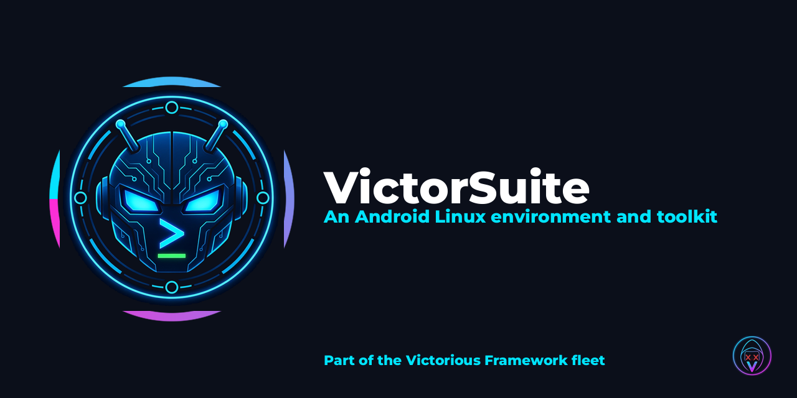

<div align="center">



# VictorSuite

**An Android Linux environment and toolkit — containers, backup/restore, plugins, X11, AI coding agents and automation.**

Works on its own; fleet integration (droidcommand-AI) is optional

VictorSuite also works fully without VictorLinux or other fleet apps.

<p>
  <a href="https://github.com/Victorious93/VictorSuite/releases/tag/v0.118.3.65"></a>
  <a href="LICENSE.md"></a>
  <a href="https://github.com/Victorious93/VictorSuite/actions"></a>
  <a href="https://victorious-framework.pages.dev"></a>
</p>

</div>

**Package id:** `com.termux` (display name is VictorSuite — do not refer to this app as Termux). VictorSuite and upstream Termux cannot be installed on the same device.

VictorSuite is an Android Linux environment maintained by Victorious93. It keeps Termux’s `applicationId` (`com.termux`) and the public `RUN_COMMAND` contract so existing Termux tooling and intents still work.

> **Credits:** VictorSuite is a modified version of [Termux](https://github.com/termux/termux-app) and [ZeroTermux](https://github.com/hanxinhao000/ZeroTermux) by hanxinhao000 (both GPLv3). Full credits and bundled-library licences: [THIRD_PARTY_NOTICES.md](THIRD_PARTY_NOTICES.md).

It is intended for personal learning, experimentation, and technical collaboration — not as a commercial product.

> **Fleet note:** VictorSuite is the third companion Android app in [Victorious93/droidcommand-AI](https://github.com/Victorious93/droidcommand-AI)’s app fleet (alongside hackeraiETC and Pentest-Swarm-AI). Because VictorSuite keeps `com.termux` and `RUN_COMMAND` unchanged, droidcommand-AI’s `core-termux` module already reaches it — and cannot tell it apart from upstream Termux. **VictorSuite and genuine Termux cannot be installed on the same device.** See that repo’s `docs/ARCHITECTURE.md` and `docs/AUDIT_2026-09-05.md`.

## Features

Documented and present in the codebase (VictorSuite features, under the `com.termux.victor` package):

- **Linux containers** — install and switch between proot-based distributions (catalogue includes Ubuntu, Kali, Fedora, BlackArch, Kali NetHunter Rootless, and others via online-script / repository JSON).
- **Backup and restore** — archive Termux environments and user data (`.tar.gz`, `.tar.bz2`, `.tar.xz`, `.tar.Z`).
- **One-command / menu-driven setup** — drawer menu and online-script catalogue for provisioning workflows.
- **Runtime repository selection** — choose package sources for the environment.
- **Plugin framework** — register, authorize, enable, and launch user-installed tools with an audit log and encrypted settings store (see [PLUGINS.md](PLUGINS.md)). The framework does **not** download or implement specific tools.
- **Embedded services** — FTP server, HTTP/ttyd-style service, file browser integrations.
- **X11 support** — separately distributed internal-channel X11 AAR; Termux:X11–style desktop workflows.
- **scrcpy / QEMU / wireless ADB / root shell** — integrations under `victor` (scrcpy, UTermux/QEMU windows, wireless ADB, libsu).
- **DroidCommand AI** — the AI option in the right drawer and Settings opens the separate DroidCommand AI app (`ai.droidcommand.app`). VictorSuite no longer includes an in-app DeepSeek or Claude chat.
- **AI CLI setup script** — bundled `scripts/ai-cli-setup.sh` installs pi, Copilot CLI, Codex CLI, and Hugging Face CLI (some via an Ubuntu proot container). **Not yet run on a real device** — see [docs/AI_CLIS.md](docs/AI_CLIS.md).
- **AI Coding Agents pack** — menu **ZT features → AI Coding Agents** installs Claude Code, Codex CLI, Copilot CLI, and Ollama (local or remote) via `ai-agents-pack.sh`, with `vsphone` (root/Shizuku phone-control bridge + approval gates) and `vstoken` (token minimizer / model routing). See [docs/AI_CODING_AGENTS.md](docs/AI_CODING_AGENTS.md). **Shellchecked + unit-tested locally; not device-tested.**
- **GitHub Releases** — CI publishes a signed pre-release APK after a successful signed build on `main` (pre-release because not device-tested).
- **Package id remains `com.termux`** — a brief attempt to move to `com.victorious.suite` was reverted (#62) so Termux IPC / `RUN_COMMAND` stay compatible. VictorSuite and upstream Termux still cannot share a device.
- **Prebuilt APK releases** and shared signing-key compatibility with UTermux (as noted historically in this project).

Upstream Termux capabilities (terminal emulator, packages via bootstrap, `RUN_COMMAND`) remain the foundation.

## Screenshots

> Placeholders — add device captures when you publish or document a release.

| Terminal | Drawer / main menu | Container manager | Backup/restore | Plugin list | X11 session |
|---|---|---|---|---|---|
| *TODO* | *TODO* | *TODO* | *TODO* | *TODO* | *TODO* |

## Install / download

Pre-release builds signed by CI — **not device-tested**. Install only if you understand the risk.

The current release is **[v0.118.3.65](https://github.com/Victorious93/VictorSuite/releases/tag/v0.118.3.65)** (published 1:34 PM EST, Nov 19, 2026). It matches `versionName` `0.118.3.65` / `versionCode` `127` on `main`. All published GitHub releases are pre-releases, so [github.com/Victorious93/VictorSuite/releases/latest](https://github.com/Victorious93/VictorSuite/releases/latest) is not a valid link (it returns 404).

- APK for most phones (`arm64-v8a`): [`termux-app_apt-android-7-release_arm64-v8a.apk`](https://github.com/Victorious93/VictorSuite/releases/download/v0.118.3.65/termux-app_apt-android-7-release_arm64-v8a.apk)
- Other ABIs and a `universal` APK are on the same release page. Prefer the ABI-specific APK; use `universal` only if needed.
- Checksums: [`SHA256SUMS`](https://github.com/Victorious93/VictorSuite/releases/download/v0.118.3.65/SHA256SUMS)
- Release list: <https://github.com/Victorious93/VictorSuite/releases>

## Requirements

- Android device with **API 23+** (`minSdkVersion` 23; `targetSdkVersion` 28; `compileSdkVersion` 36)
- JDK **17** for building (CI uses Temurin 17)
- Android SDK platform 36, build-tools 36, NDK **29.0.14206865** (see `gradle.properties`)
- Note: package id is `com.termux` — uninstall upstream Termux first if both would conflict

## Build

```sh
git clone https://github.com/Victorious93/VictorSuite.git
cd VictorSuite

# Debug APK (all ABIs)
./gradlew :app:assembleDebug --stacktrace

# Unit tests (JVM)
./gradlew :app:test :termux-shared:test

# Checkstyle (ignoreFailures = true in this project)
./gradlew checkstyle
```

`TERMUX_PACKAGE_VARIANT` selects the bootstrap variant baked into the APK (`apt-android-7` by default, or `apt-android-5`). NDK version is set in `gradle.properties` (`ndkVersion`) and can be overridden via `JITPACK_NDK_VERSION`.

CI (`.github/workflows/android.yml`) runs `:app:assembleDebug` on pushes/PRs to `main`.

Current `versionName` / `versionCode` (from `app/build.gradle`): **[0.118.3.65](https://github.com/Victorious93/VictorSuite/releases/tag/v0.118.3.65)** / **127**.

## Manual

How-to: [docs/MANUAL.md](docs/MANUAL.md)

## Usage

1. Install a debug or release APK (sideload).
2. Open VictorSuite — first launch follows Termux-style bootstrap / setup.
3. Use the drawer menu for VictorSuite features (containers, backup, FTP, X11 settings, online scripts, AI CLIs, etc.).
4. For plugins: register from the remote catalogue → acknowledge authorized use → enable → place the entry-point binary yourself. See [PLUGINS.md](PLUGINS.md).
5. For AI CLIs from the terminal: menu **AI CLIs**, or `bash ~/ai-cli-setup.sh` after the asset is copied — details in [docs/AI_CLIS.md](docs/AI_CLIS.md).

Remote JSON catalogues (served via `raw.githubusercontent.com` from this repo):

- `remote/plugins/main.json` — plugin catalogue
- `remote/repository/main.json` — module/bootstrap listing
- `remote/on_line_sh/main.json` — online script catalogue

## Project structure

```text
app/                    Main application (Termux entry points + com.termux.victor.*)
terminal-emulator/      VT100/xterm state machine (Java/JNI)
terminal-view/          Android View rendering the emulator
termux-shared/          Shared Termux utilities
remote/                 Plugin, repository, and online-script JSON manifests
scripts/                ai-cli-setup.sh (bundled as an app asset)
docs/                   AI_CLIS.md and related notes
art/                    Icon / banner generation helpers
```

VictorSuite changes in upstream Termux files are wrapped in `// VictorSuite add {@` / `// VictorSuite modify {@` markers. Prefer **Kotlin** for new `victor` code.

## Victorious fleet

VictorSuite is part of the [Victorious Framework](https://victorious-framework.pages.dev), a family of Android and PC tools by Don Victor. **It works standalone; fleet integrations are optional.** Related: [droidcommand-AI](https://github.com/Victorious93/droidcommand-AI), [VictorLinux](https://github.com/Victorious93/VictorLinux), [File-Manager](https://github.com/Victorious93/File-Manager). The roster is in [victorious-fleet](https://github.com/Victorious93/victorious-fleet) and live status is in [fleet-manifest](https://github.com/Victorious93/fleet-manifest).

## Contributing

This repository is private. If you have access:

1. Prefer small, reviewable PRs.
2. Keep Termux `applicationId` / `RUN_COMMAND` behaviour intact unless the change is intentional and documented.
3. Do not commit secrets; treat keystores and API keys as sensitive.
4. Plugin framework PRs must preserve the authorized-use gate (register → acknowledge → enable).

## Licence

VictorSuite is released under the **GNU General Public License v3** (see [LICENSE.md](LICENSE.md)), following the Termux / ZeroTermux lineage. Credits and bundled-library licences, including open compliance items, are in [THIRD_PARTY_NOTICES.md](THIRD_PARTY_NOTICES.md).

Exceptions called out in `LICENSE.md` include:

- Terminal Emulator for Android code — Apache-2.0 (`terminal-view`, `terminal-emulator`)
- libcore/ojluni file utilities — GPLv2 with Classpath exception
- libsuperuser `StreamGobbler` — Apache-2.0

Application icons are credited to the Alibaba Iconfont library in the historical project README.

Users are responsible for any recovery packages, modules, or third-party software they install. Do not use the project for unlawful activities.

## Acknowledgements

Built on the work of Termux, Termux:Tasker, Termux:API, Termux:Styling, Termux Packages, ZeroTermux, and many libraries listed in prior project acknowledgements (ImagePicker, VShell, AgentWeb, XXPermissions, libaums, Glide, ttyd, File Browser, Swiftp, ImmersionBar, CodeEditor, and others). Please support upstream maintainers directly when you can.

## Release retention

Each push to `main` that bumps `versionName` auto-publishes a signed pre-release. After it publishes, CI deletes all older GitHub releases (including stale drafts) so only the latest remains. Git tags are never deleted, so every past build stays traceable to its exact source (GPL).
